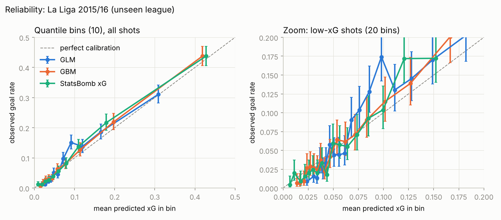
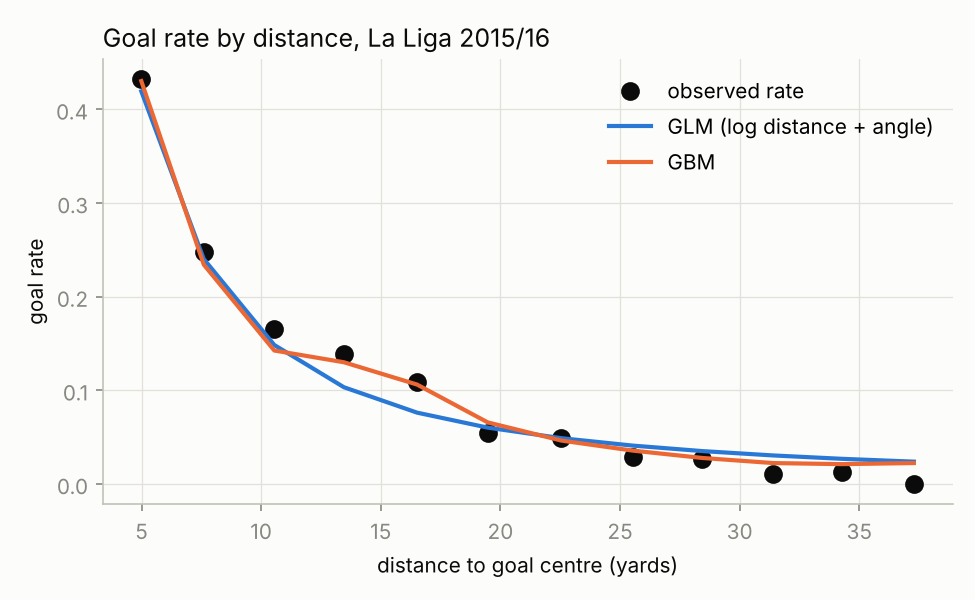
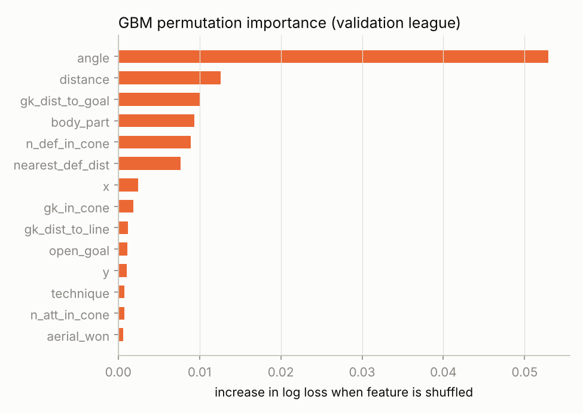
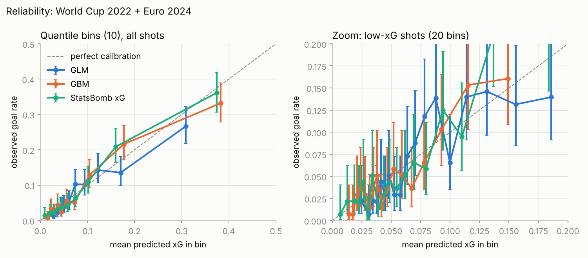

# Expected goals (xG) on StatsBomb open data

An expected-goals model built with an emphasis on validation rather than leaderboard numbers: leave-league-out splits, proper scoring rules, calibration checks, and match-level bootstrap confidence intervals, benchmarked against StatsBomb's own xG.

**Data:** [StatsBomb open data](https://github.com/statsbomb/open-data) - 41,052 non-penalty shots from 1,666 matches.


## Results at a glance

**Unseen league (La Liga 2015/16)**, scored once after all modelling decisions were fixed:

| Model | Log loss (95% CI) | Brier | Brier skill | AUC | Calib. slope |
|---|---|---|---|---|---|
| Logistic regression: log distance + angle | 0.292 (0.280 - 0.306) | 0.084 | 0.10 | 0.76 | 1.08 |
| Gradient boosting: geometry + context + freeze frame | **0.259** (0.247 - 0.272) | 0.075 | 0.20 | 0.83 | 1.09 |
| StatsBomb xG (benchmark) | 0.255 (0.244 - 0.269) | 0.074 | 0.21 | 0.83 | 1.08 |

**Paired differences in log loss** (same bootstrap resamples, so the shared match-to-match noise cancels):

- **GBM - GLM:** -0.033 (-0.038 to -0.028). The richer model is clearly better.
- **GBM - StatsBomb:** +0.004 (+0.001 to +0.007). StatsBomb's commercial model is still slightly better on the unseen league.

**Out-of-population check (World Cup 2022 + Euro 2024):**

| Model | Log loss | Calibration slope |
|---|---|---|
| GLM | 0.276 | 0.96 |
| GBM | 0.252 | 1.00 |
| StatsBomb xG | 0.247 | 1.03 |

The GBM - StatsBomb gap here is +0.005 (-0.001 to +0.010), consistent with zero.



## Validation design

Shots from the same league share referees, styles of play and finishing quality. A random train/test split therefore lets the model memorise league-level effects and reports optimistic numbers. Instead, whole competitions are held out:

| Role | Competitions | Matches | Shots |
|---|---|---|---|
| Train | Premier League, Serie A, Bundesliga* (2015/16) | 794 | 20,524 |
| Validation (all tuning) | Ligue 1 2015/16 | 377 | 8,723 |
| Test (touched once) | La Liga 2015/16 | 380 | 9,071 |
| Out-of-population test | World Cup 2022, Euro 2024 | 115 | 2,734 |

\*Only 34 Bundesliga 2015/16 matches are in the open data.

**Why the 2015/16 La Liga season, not the other La Liga seasons in the open data?** The other La Liga seasons in the open data contain only Barcelona matches. A sample built around one dominant team is biased in both who shoots and who finishes. 2015/16 is a complete season.

**Selection vs evaluation.**
- Hyperparameters, and the number of trees (read off the staged validation curve), were chosen on Ligue 1 alone.
- The final models were then refit on train + validation with those settings and scored once on La Liga.

This matters in practice. On the tuning league the GBM *beat* StatsBomb xG (0.2539 vs 0.2567). On the unseen league it did not. The validation number carries selection optimism; the test number doesn't.

## Data decisions

- **Penalties removed** (445 shots). Penalties convert at a near-constant rate and would inflate apparent skill. They are better treated as a fixed value.
- **Shoot-outs removed** (period 5).
- **Free kicks kept,** with `shot_type` as a feature.
- **Leakage guard:** only information available *before* the ball is struck is used. Shot outcome, end location, the deflection flag and StatsBomb's xG are excluded from the features. StatsBomb xG is kept only as a benchmark column.
- **Coordinates:** StatsBomb's 120 x 80 pitch, always attacking towards x = 120, so the goal is centred at (120, 40) with posts at y = 36 and y = 44.

## Models

**1. Logistic regression baseline (GLM).**

`logit P(goal) = b0 + b1·log(distance) + b2·angle`, unpenalised, fitted on the training leagues:

| | coef | std. error | z |
|---|---|---|---|
| intercept | 1.02 | 0.39 | 2.6 |
| log distance | -1.35 | 0.11 | -11.9 |
| angle (rad) | 0.60 | 0.18 | 3.4 |

- Standard errors come from the inverse Fisher information, `(XᵀWX)⁻¹` with `W = diag(p(1-p))`.
- Distance and angle are strongly correlated, so the angle coefficient is the effect *at fixed distance*.
- `angle` is the angle subtended by the two posts as seen from the shooter (the visible goal mouth), not the angle to the goal centre.
- Log distance was chosen after comparing binned goal rates against distance. The relationship is steep inside 10 yards and flat beyond 25.



**2. Gradient boosting (scikit-learn `HistGradientBoostingClassifier`).** Features:

- **Geometry:** distance, angle, x, y.
- **Context:** body part, shot type, technique, play pattern, under pressure, first time, one-on-one, follows dribble, aerial won, open goal.
- **Freeze frame**, i.e. player positions at the moment of the shot:
  - defenders and attackers inside the shooter-posts triangle
  - whether the goalkeeper is inside it
  - goalkeeper distance to goal and to the shot line
  - nearest-defender distance
  - defenders within 3 yards

Missing values are handled natively. Categorical levels not seen in training map to "missing" rather than to an arbitrary code. The tuned settings are learning rate 0.02, 31 leaves, minimum 40 samples per leaf, and 173 trees.

**Ablation on the unseen league** (same protocol each time) shows where the gain comes from:

| GBM variant | Log loss |
|---|---|
| distance + angle only | 0.290 |
| + shot context (no freeze frame) | 0.269 |
| + freeze frame (full model) | 0.259 |

With only geometry, the flexible model barely beats the GLM (0.290 vs 0.292). Almost all of the improvement comes from *information*, not *model flexibility*. About a third of it comes from defender and goalkeeper positions.



Permutation importance is computed on the validation league. Because distance and angle are correlated, their importances share credit and should not be read separately.

## Calibration

- **Reliability curves** use quantile bins with Wilson 95% intervals. Most shots are under 0.1 xG, so equal-width bins leave the upper bins nearly empty.
- **Calibration slope:** the slope from regressing the outcome on logit(p).
- **Calibration-in-the-large:** mean prediction minus goal rate.

What the curves show:

- On the training-like populations, all models are close to the diagonal.
- **La Liga 2015/16 has a higher goal rate (10.4%) than the training leagues (9.0%).** Every model, including StatsBomb's, has a calibration slope of about 1.08 there: high-quality chances were converted more often than the models expect. This is a league-season shift rather than a model defect. Plausibly it reflects the concentration of elite finishers that season, though the data here can't establish the cause.
- **On the tournaments, slopes are about 1.0.** That calibration transfers well beyond club football.



## Uncertainty

All confidence intervals come from a **match-level bootstrap** (1,000 resamples).

- Shots in the same match share teams, score state and conditions, so they are not independent.
- Resampling individual shots would understate the uncertainty.
- Every model is scored on the same resample, which gives valid paired intervals for model differences.

## Limitations

- The benchmark is not a clean comparison. StatsBomb xG is trained on a far larger proprietary dataset that may include these matches, and it uses inputs not in the open data.
- One league-season is a single draw from the population of "unseen leagues". A leave-one-league-out rotation over all four full leagues would show how much the test score varies.
- Freeze frames record positions, not velocities or the goalkeeper's set position.
- Player finishing skill is deliberately not modelled. xG describes the chance, not the finisher.

## Reproduce

```bash
pip install -r requirements.txt
python scripts/build_dataset.py      # downloads ~1,700 match files from GitHub on first run (cached in data/raw)
python scripts/run_experiments.py    # every number and figure in this README -> reports/
pytest                               # geometry and freeze-frame unit tests
```

If you have a local clone of `statsbomb/open-data`, run `python scripts/build_dataset.py --source path/to/open-data/data` to skip the download.

## Repository layout

```
src/xg/load.py        read StatsBomb JSON -> one row per shot
src/xg/features.py    distance, goal-mouth angle, freeze-frame features
src/xg/models.py      GLM (+ Fisher standard errors), gradient boosting wrapper
src/xg/evaluate.py    log loss, Brier, calibration slope, reliability bins, match bootstrap
scripts/              dataset build and full experiment run
tests/                unit tests for the geometry
reports/              results.json, run log, figures
```

## Data credit

Data provided by [StatsBomb](https://statsbomb.com/) via their [open-data repository](https://github.com/statsbomb/open-data), used under the StatsBomb public data user agreement.
